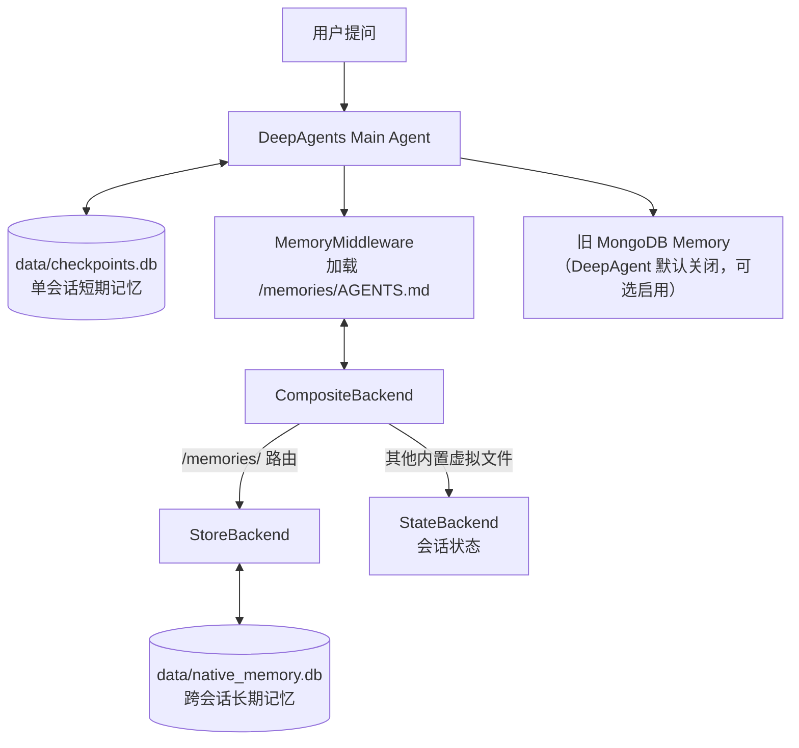

# MultiAgent-Search：DeepAgents 原生长期记忆（独立开发分支）

**分支**：`feature/deepagents-native-memory`  
**基线**：`feature/deepagents-chat-integrated`  
**DeepAgents 版本**：保持 `0.4.3`（经对照该版本源代码，已支持 `backend` / `memory` / `store`，暂不升级）

## 1. 原理和三个数据库



- **Checkpoint（短期）**：按 `thread_id` 保存运行状态，仅同一聊天线程复用。
- **LangGraph Store（长期）**：通过 `("deepagents_memory", user_id)` 命名空间保存与聊天线程无关的持久化虚拟文件。
- **MongoDB（既有独立 Memory）**：原有 Extractor/Manager/Recall 代码、数据和 Collaboration 模式保持不动。

`/memories/AGENTS.md` 是 DeepAgents 能看到的**虚拟文件路径**。经过 `CompositeBackend` 后，它实际对应 Store 中的键 `/AGENTS.md`，并不是项目根目录下的真实 Markdown 文件。

## 2. 实际新增和改动

| 文件 | 改动 |
|---|---|
| `agent/memory/native.py` | 新增持久化 Store 生命周期、命名空间、Backend 工厂、记忆文件初始化 |
| `agent/memory/manage.py` | 对偏好按 key 增加/更新、去重、删除，尽量不改动其他段落 |
| `agent/memory/tools.py` | 三个可供模型主动调用的保存/删除/查看工具，写后校验 |
| `agent/memory/refresh.py` | 每轮从 Store 重新加载 AGENTS.md，避免旧 thread 缓存过时 |
| `agent/main_agent.py` | 配置 `backend`、`memory`、`store`；区分虚拟记忆文件与报告输出 |
| `api/chat/service.py` | 默认不再为 DeepAgents 调用旧 MongoDB Extractor（防止重复） |
| `tests/test_native_memory.py` | 记忆文件保存、重新连接、命名空间隔离 |
| `tests/test_native_memory_agent.py` | 无网络假模型验证实际 `create_deep_agent()` 加载 AGENTS.md |
| `tests/test_native_memory_management.py` | 相同 key 去重/更新/删除、真实工具调用、同 thread 连续追问刷新 |
| `.github/workflows/native-memory-check.yml` | 语法、存储、Agent Middleware、聊天数据库回归测试 |

旧分支未被覆盖。

## 3. 三个关键配置

在 `agent/main_agent.py` 的 `init_main_agent()` 中：

```python
memory_store = await init_native_store()

main_agent = create_deep_agent(
    # 现有的 model、tools、subagents 原样保留
    checkpointer=checkpointer,
    store=memory_store,               # 真正持久化到 SQLite 的 BaseStore
    backend=backend_factory_for(),   # /memories/ 走 StoreBackend
    memory=["/memories/AGENTS.md"],  # MemoryMiddleware 加载这个文件
)
```

**仅添加 `memory=[...]` 不会自动保证持久化。** 必须提供正确的 Backend 和持久化 Store；只用 `InMemoryStore` 无法跨服务重启持久保存。

这套代码对 `deepagents==0.4.3` 使用 `lambda runtime` 风格的 Backend 工厂，不直接套新版 API 的零参数写法。

## 4. 本地同步与启动（PowerShell）

请先保存或提交本地未提交修改，再切换远端分支：

```powershell
git status
git fetch origin
git switch --track origin/feature/deepagents-native-memory
python -m compileall -q agent api tools
python -m unittest discover -s tests -p "test_native_memory.py" -v
python -m unittest discover -s tests -p "test_native_memory_agent.py" -v
python -m unittest discover -s tests -p "test_native_memory_management.py" -v
python api/server.py
```

浏览器访问 http://127.0.0.1:8000 。

如果本地已有同名分支，可用 `git switch feature/deepagents-native-memory` 与 `git pull --ff-only`；不要使用 `git reset --hard`。

## 5. 实际功能验证（不调用 MongoDB）

确保 `.env` 没有启用 `DEEPAGENT_MONGO_MEMORY_ENABLED=1`。本次新分支默认使用原生 Memory；旧 MongoDB 记忆仍可用于协作模式。

- **新聊天 A（DeepAgents 智能模式）**：发送“请把这个长期偏好写入 `/memories/AGENTS.md`：以后解释 Python 代码要给详细中文注释。请实际调用 read_file / edit_file 更新，不要只在文字中说已经记住。”
- 查看右侧日志，确认有 `read_file` / `edit_file` 工具调用。**如果没有实际文件工具调用，不能视为写入成功**。
- **新聊天 B（DeepAgents 智能模式）**：发送“我之前让你记住了怎样的 Python 讲解偏好？”。注意，这里是全新的 `conversation_id` 和 `thread_id`。
- 关闭服务、重新运行 `python api/server.py`，再创建新聊天 C 并提问相同问题，验证 SQLite 文件的持久化。

这里先检验原生 Memory，避免此前“蓝鲸27”测试中长期 MongoDB 和短期 Checkpoint 共同影响结果的混淆。

## 6. 手动检查 AGENTS.md（独立临时文件）

如需要确认数据库内容，可以暂时停止服务，并在项目根目录创建/复用唯一的 `temp_test.py`：

```python
import asyncio
from agent.memory.native import (
    init_native_store,
    read_native_memory,
    close_native_store,
)

async def main():
    try:
        store = await init_native_store()
        content = await read_native_memory(store)
        print(content)
    finally:
        await close_native_store()

asyncio.run(main())
```

运行 `python temp_test.py` 即可；测试结束覆盖或删除此文件。

## 7. 配置、兼容性和安全边界

- `NATIVE_MEMORY_USER_ID=local_user` 为**本地单用户环境**的默认命名空间；若之后做多租户，必须在通过身份认证之后传入受信任的 user_id，而不是相信前端任意传来的 ID。测试已覆盖不同命名空间隔离，不代表整个 Web 产品已有身份认证。
- `DEEPAGENT_MONGO_MEMORY_ENABLED=0`（默认）让 DeepAgents 原生长期记忆与旧 MongoDB Recall 分离；旧开关设为 `1` 仍受支持，但新推荐用 `DEEPAGENT_MEMORY_MODE=hybrid`；混合模式 MongoDB 只处理 `user_profile` / `project_fact` / `decision`，不会重复写入和召回 `preference`。Collaboration 模式仍保持原有 MongoDB Memory，但 MongoDB 查询现在按本地用户范围隔离。
- `data/native_memory.db` 要持久保存并备份；服务停止时关闭连接，但不会删除文件。
- AGENTS.md 是**默认加载的长期上下文**，不适合无限追加大量项目事实；只保存少量明确、稳定且不敏感的偏好、事实。后续大量事实仍适合结构化 MongoDB 检索。
- `MemoryMiddleware` 不等于自动提取器；**模型必须实际调用 save_long_term_preference 或文件工具才会保存新增内容**。不要把“AI 说记住了”当成写入证明。
- DeepAgents 0.4.3 原生 MemoryMiddleware 在状态已有 `memory_contents` 时会跳过加载。本分支新增 `RefreshNativeMemoryMiddleware`，每轮从 SQLite Store 读取最新 AGENTS.md 覆盖缓存；已通过同 thread 的增改删自动化测试。
- 整套应用当前没有完善的身份认证和细粒度权限控制，Web 服务不应直接暴露公网使用；尤其要谨慎赋予模型文件和数据库写操作权限。
- GitHub Actions 验证不消耗模型额度；**真实 Qwen 调用及真实模型自主选择记忆工具仍需本地手动验收**。

## 8. 面试可用的实现说明

> 项目的短期记忆由 LangGraph Checkpointer + thread_id 实现；长期记忆使用 DeepAgents 自带的 MemoryMiddleware，从 /memories/AGENTS.md 加载稳定的用户偏好。通过 CompositeBackend 把记忆路径路由到 StoreBackend，底层使用持久化 SQLite Store；Store 的命名空间不依赖 thread_id，因此不同聊天可以复用同一用户长期记忆。原有 MongoDB 结构化记忆仍保留，专门面向数量多、需筛选召回的项目事实。这两层存储职责不同，并做了隔离，避免重复注入。


## 9. 第二阶段：可验证的长期偏好管理

本阶段已新增三个给 Main Agent 调用的工具：

| 工具名 | 意义 | 数据库结果 |
|---|---|---|
| `save_long_term_preference(key, value)` | 保存或更新一条用户明确指定的长期偏好 | 同 key 内容相同不重复，内容变化则替换旧值，写后回读 |
| `forget_long_term_preference(key)` | 删除一个指定偏好 | 删后回读校验 |
| `list_long_term_preferences()` | 列出通过管理工具保存的偏好 | 实际读取 SQLite |

示例：在聊天 A 中说“以后讲 Python 代码请给详细中文注释，记住这条偏好”，Agent 应调用 `save_long_term_preference`，键可用 `python_explanation_style`。

在同一聊天 A 继续说“把刚才的偏好改成简洁示例”，应当使用**相同的 key** 调用 `save_long_term_preference`，不会新增第二条重复偏好。重新询问偏好时，`RefreshNativeMemoryMiddleware` 会加载最新持久化内容。

再新建聊天 B，问“你记得我偏好的 Python 讲解风格吗？”以检验跨 thread 召回。也可发送“请调用 list_long_term_preferences 查看真实保存的内容”，检查数据库状态。

最后在聊天 B 说“忘记我之前的 Python 讲解偏好”，应调用 `forget_long_term_preference`，然后同一聊天和新聊天里都不应再通过长期记忆看到这一条。要注意**同一聊天中之前的用户消息仍属于短期记忆**，即使长期记忆删除，模型仍可能根据聊天历史回忆起旧说法，所以删除长期记忆应以数据库中的内容为准，而不是只看模型是否还答得出来。

### 验收用语（顺序执行）

1. **聊天 A**：`请记住：以后解释 Python 代码时要提供详细的中文注释。请调用 save_long_term_preference，key 用 python_explanation_style。`
2. **聊天 A**：`请将刚才的偏好改成：先给一个最简单的可运行示例，再解释原理；仍使用 python_explanation_style 这个 key。`
3. **新聊天 B**：`请列出我保存的长期偏好，并说出 python_explanation_style 的当前值。`
4. **聊天 B**：`请调用 forget_long_term_preference，删除 python_explanation_style。`
5. **新聊天 C**：`请调用 list_long_term_preferences，确认现在是否还保存着 python_explanation_style。`

**局限说明**：

- 系统提示词会指导模型调用工具，但真实 Qwen 模型是否始终选对工具与稳定 key，仍需人工联调，不能仅凭模拟模型单元测试就宣称 100% 可靠。
- 敏感内容拦截是**有限的关键字防护**，不能代替完整的隐私保护、用户身份认证、审计和外部访问控制。
- `save_long_term_preference` 管理的是 AGENTS.md 内的专门小节；用户或模型用 `edit_file` 对其他段落做的编辑，不会被这个工具的列表自动归档。
- 同一用户对 AGENTS.md 进行大量并发读改写时，专用工具与通用文件工具之间还没有完善的跨进程冲突控制。正式多用户部署前需要补充。
- 现有 MongoDB Memory 没有被删除，但本阶段没有将两套自动写入逻辑同时启用，以避免存储冲突。


## 10. 第三阶段：原生 AGENTS.md + MongoDB 混合记忆（2026-10-13）

开发分支：`feature/hybrid-memory-policy`，在已经通过 CI 的 `feature/deepagents-native-memory` 上继续，仍使用已验证的 `deepagents==0.4.3`。没有升级依赖或改变 Checkpointer、工具治理和 HITL 协议。

### 10.1 为什么两套记忆不会重复

| 内容 | 负责的组件 | 注入方式 |
|---|---|---|
| 用户明确要求长期记住的偏好 | DeepAgents `/memories/AGENTS.md`，SQLite Store | MemoryMiddleware 系统上下文 |
| 较稳定的用户背景、项目事实、历史决定 | MongoDB `memories` | LLM 挑选相关记录后，通过 HybridMongoContextMiddleware 加入本轮系统上下文 |
| 当前聊天的轮次和工具状态 | SQLite Checkpointer `checkpoints.db` | LangGraph 使用相同 `thread_id` 恢复 |

**MongoDB 中以前保存的 `preference` 类型，在 DeepAgents 混合模式不再注入，也不会在混合模式新写入。** 这样避免 AGENTS.md 和 MongoDB 对同一偏好给出冲突内容。Collaboration 模式暂时继续使用自己的 MongoDB 记忆流程，尚未完全统一到 AGENTS.md。

### 10.2 为什么不再把 MongoDB 召回结果拼进用户输入

以前运行时会构造 `model_query = task_query + memory_hint + path_instruction`。其中 `memory_hint` 是 MongoDB 的召回结果，被当成 LangGraph 的用户消息保存到 Checkpoint，可能导致一条过期记忆在同一线程中反复出现。

现在：`model_query` 只包含真实用户输入和必要的目录说明；MongoDB 召回结果通过协程级 `ContextVar` 传入 `HybridMongoContextMiddleware`，只在本轮模型系统消息中注入。这避免了**主动把整段 MongoDB 召回文本存成新的用户消息**。模型回答中自行引用过的历史事实、旧版本 Checkpoint 和对话消息不受此机制清理；因此，删除长期记忆**不等于**自动删除过去的对话记录。

MongoDB 召回异常时，现有 `recall_memory_context` 会记录日志并降级为空上下文；MongoDB 的自动记忆提取异常也不应阻塞主 Agent 正常答复。

### 10.3 本地怎么启用

保持原生记忆独立运行（不依赖 MongoDB）：

```dotenv
DEEPAGENT_MEMORY_MODE=native
```

需要混合模式时，在项目本地 `.env` 写：

```dotenv
DEEPAGENT_MEMORY_MODE=hybrid
MONGO_URI=mongodb://localhost:27017
MONGO_DB_NAME=multiagent_memory
```

然后重启 FastAPI。项目旧版开关 `DEEPAGENT_MONGO_MEMORY_ENABLED=1` 仍兼容，但**建议只使用新的 `DEEPAGENT_MEMORY_MODE`**，避免配置语义混淆。若需要完全关闭 MongoDB，请同时移除旧开关或设置为 0。

新模式以当前受信任的本地用户 ID 隔离记录，缺省是 `NATIVE_MEMORY_USER_ID=local_user`。目前 Web 应用仍然是**本地单用户设计，没有真正登录认证**，切勿把手动指定本地 user_id 当作多用户安全认证机制。

### 10.4 现有 MongoDB 老数据如何处理

原始代码把所有记忆存在 `multiagent_memory.memories`，记录中没有 `owner_id`。原版对 `get_all_memories` 使用无条件 `find({})`。

新分支的 MongoDB Repository 每次 `get_all_memories`、`get_memories_by_type`、`update_memory` 都要求 `owner_id` 等于当前可信用户。新写入自动带 `owner_id`。

**重要：旧 MongoDB 记录没有删除，但默认不会被新查询看到！** 对旧记录不要直接批量设置为任意当前用户，因为其中可能包含别人的数据。先备份 MongoDB、人工确认单用户数据库的归属，再单独迁移；本分支没有隐式迁移或修改旧记录。

### 10.5 本次 CI 自动测试

- 原来的短期聊天 Store、原生长期记忆、真实 DeepAgents MemoryMiddleware、同线程记忆刷新、偏好增删改测试仍然执行。
- 新增 `tests/test_hybrid_memory.py`：验证 MongoDB 类型过滤、旧记录隔离、不同 owner 的读写更新权限、协程并发上下文隔离、hybrid/native 配置开关。
- 这些测试用伪 MongoDB collection + 模拟上下文对象运行，不需要连接 MongoDB 或调用 Qwen，因此**只能说明业务规则及核心调用链通过测试**。

### 10.6 最后的本地端到端验收（需要用户机器有模型密钥与 MongoDB）

1. 在 `.env` 写 `DEEPAGENT_MEMORY_MODE=hybrid`，并保证 MongoDB 正常运行，然后启动 `python api/server.py`。
2. 聊天 A：明确告诉 Agent 一个稳定的项目事实（例如测试项目的检索系统使用某一版本技术栈）；观察是否有 MongoDB Memory 提取/写入日志。这个过程由 LLM Extractor/Manager 决定，不保证每句话都保存。
3. 新聊天 B：只问该项目事实；查看 MongoDB Recall 日志并核对答案。请与 AGENTS.md 的偏好测试区分开。
4. 同时让 Agent 用 `save_long_term_preference` 写入明确偏好，再在不同聊天提问偏好；观察该偏好仅在 AGENTS.md 中保留，混合模式不会将其作为新的 MongoDB preference 候选存入。
5. 关闭 MongoDB 或切换到 `native` 模式，确认 DeepAgents 仍能正常回答和使用 AGENTS.md。重启服务，再验证原生长期记忆可以恢复。
6. 如果此前有 `owner_id` 为空的旧记录，确认它们不会自动进入新用户的记忆上下文，并使用人工备份/检查流程决定如何处理。

### 10.7 尚未宣称完成的项目

- **真实 Qwen + 真实 MongoDB 联调**：自动化 CI 环境不拥有你的 Qwen API 密钥或本机 MongoDB 服务，不能以模拟模型测试代替真实环境验收。
- **正式多用户支持**：目前只有可信本地默认 `user_id`，需要认证、用户绑定和访问授权才能上线多租户。
- **复杂语义冲突**：单个 AGENTS.md 记忆偏好内的去重按 key 管理，MongoDB 相似事实的去重依赖现有 LLM Manager；跨两种来源的语义一致性仍需业务验证。
- **记忆彻底遗忘**：删除长期记忆不会自动清空曾引用该事实的对话消息、Checkpoint 和其他存储副本。
